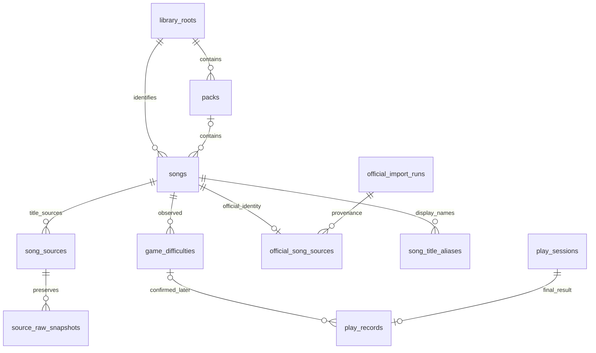

# Phase 3.5 SQLite 資料模型

應用版本 0.5.0，資料庫 schema 5，報告 JSON schema 5。預設檔案 `data/library.sqlite3`，禁止放在 SONG 內。提供歌曲庫 GUI 與手動遊戲難度編輯；沒有 OCR、成績擷取或非 HOST 人工配對介面。

## 身分與歌曲來源

| 表 | 主鍵與主要欄位 | 規則 |
|---|---|---|
| library_roots | root_id, path, path_key, root_kind | 區分 filesystem 與 official_catalog；只有前者是 SONG 磁碟目錄 |
| packs | pack_id, root_id, name, relative_path, pack_type | 同根目錄／相對路徑唯一；pack_type 為 normal／multiplayer_download |
| songs | song_id, pack_id, folder_name, relative_folder, latest_title, saved_title, artist, source_format, format_status | relative_folder 對應規格的 relative_path；根目錄＋相對資料夾路徑唯一 |
| song_sources | source_id, song_id, relative_path, format, latest_sha256, saved_title, saved_subtitle, saved_artist, payload_json | 名稱／Artist／原始欄位／編碼／診斷及上次可確認值 |
| source_raw_snapshots | snapshot_id, source_id, sha256, raw_data BLOB, reason, first_scan_id | 保留非 UTF-8 舊編碼／未知編碼原始 bytes；同來源及雜湊唯一 |
| song_title_aliases | alias_id, song_id, display_title, source, confirmed | 遊戲畫面／人工名稱與原始 Title 分開保存；同一顯示名稱可對應不同歌曲，不可單靠歌名自動合併 |
| scan_runs | scan_id, root_id, scopes_json, complete, report_json | 保留歷次掃描快照 |

SongFolder 才是歌曲單位。歌名、Artist、BPM、檔案雜湊相同都不合併不同 SongFolder。Pack／Song ID 由 SQLite 保存，重掃只更新既有路徑資料，不使用 DELETE 或 INSERT OR REPLACE。

`latest_title` 是本次歌名，可能 NULL；`saved_title` 只在名稱可靠且來源顯示名一致時更新。其他欄位編碼警告不抹去可靠歌名；待確認時保留上次值。Title／Subtitle 與 Artist 原值、候選、實際欄位編碼保存於來源 payload_json；saved_artist 獨立保留上次可靠 Artist。Song.artist 暫不統合，不以作者決定歌曲身分。

來源格式只有 sm／dwi／osu。SM＋DWI 共存保留為一般資訊，不拆歌、不因共存降低名稱可信度；混合格式 source_format=NULL、format_status=mixed，實際組合由 song_sources 得知。同時含 osu 與 SM／DWI 產生 SOURCE_FORMAT_REVIEW，供人工檢查，不選優先格式。

connect 具有正常管理 Pack 關聯，pack_type=multiplayer_download；目前根目錄的 Pack ID 是 40。舊 39 Pack ID 不變。這是儲存／管理 Pack，不宣稱已知道原始 Pack，也不替非 HOST 成績自動配對。不同資料夾同名保持不同 Song ID；移動／改名暫不自動合併，歷史保留。

## 遊戲難度與觀測值

`game_difficulties` 由舊 charts 改名，chart_id 改名為 difficulty_id，既有 ID 不變。

| 欄位 | 規則 |
|---|---|
| difficulty_id | 內部穩定主鍵 |
| song_id | 外鍵 Song，禁止刪除仍有關聯的歌曲 |
| difficulty | 只允許 EASY／NORMAL／HARD；同 Song＋difficulty 唯一 |
| game_level | 可 NULL，使用者手動輸入遊戲實際值或可靠遊戲畫面提供，原始 meter／Version 不得填入 |
| level_source | manual／game_screen／official_csv 或 NULL；舊數值保留但不自動宣稱來源已確認 |
| total_notes | 可 NULL，已知時須大於 0 |
| notes_source | manual／game_screen／completed_judgment_sum／official_csv，未知為 NULL |
| notes_verified | 預設 0；沒有 total_notes 時不可為 1 |

自製檔案匯入器不建立遊戲難度列；官方 CSV 可依有效 E／N／H 正值建立 official_csv 難度；可有零、一、二或三個已觀測難度，零列代表尚未觀測，不能斷言歌曲沒有譜面。LV、音符數沒有可靠資料時維持 NULL。重掃不改動任何遊戲觀測或成績。

完整音符數優先取遊戲畫面。非 HOST 只能在本人 COMPLETED 後以 P+C+B+M 作候補並保存來源。FAILED 的部分判定不能推成完整音符數。未驗證或相互矛盾的觀測不得自動覆蓋已驗證值；本期 GUI 只支援使用者手動確認寫入；後續自動觀測需保留衝突證據再確認。手動輸入音符數會設 notes_verified=1，代表使用者確認，來源仍為 manual，不表示通過 OCR 驗證。唯讀報告只把 level_source=manual／game_screen 的 LV、notes_verified=1 的總數列入已知數值。

## 多人與歷史紀錄

`play_sessions` 保存每場本人暱稱、當次帳號、single／multiplayer、是否 HOST、official／custom／unknown、free／host_selected、本人難度與 LV、HOST 結算 LV、遊戲顯示歌名／Pack、房間狀態、本人狀態及 evidence_json。

本人 LV 和 HOST 結算 LV 是不同欄位；非 HOST 不可用底部 HOST LV 寫入本人 GameDifficulty。自由模式各人難度可以不同；統一難度也須保留當次模式證據。選歌畫面 Pack 黑色清單、切歌後難度／LV／顆數的觀測流程留待 OCR 階段實作。

`play_records` 保存 record_id、session_id、可空的 difficulty_id、played_at、P/C/B/M、ex_score、max_score、percentage、lamp_status、completion_status、完整總數與來源、match_status、validation_status 及 evidence_json。截圖路徑、本人結算列與原始畫面值等放 evidence_json；沒有 OCR 或截圖保存程式。

- 非 HOST 先保存來源未知的 Session；待配對紀錄可保持 difficulty_id=NULL、match_status=pending。確認歌曲及本人難度後才關聯，不靠歌名／HOST LV 猜配。
- 同 Session 最多一筆結果，避免本人倒下時寫一次、整場結算再寫一次。
- 本人已倒下但其他人存活：room_status=playing、player_status=failed_waiting；此時禁止寫最終 PlayRecord。
- room_status=result 且本人 completed／failed 才能保存對應 COMPLETED／FAILED。GAME OVER 只看本人列；房間有結算不代表本人通關。
- quit、disconnected、interrupted 保留 Session，不能冒充 FAILED 生成結果。更改已有結果的 Session 使其與結果矛盾也會被拒絕。
- 結算定位本人暱稱列，順位不固定，背景人物名不可當成結算列；這是後續 OCR 的規則，本期不實作辨識。

數值欄位可 NULL 以保留尚未確認證據；已填值受非負、EX=2P+C、MAX=2N、百分比及完成狀態檢查。百分比保存未四捨五入的計算值，顯示規則留待後續。verified 要有完整判定、EX 與合法燈號；ACP／AC／CLEAR 與正常完成的判定數一致。FAILED 不得寫清除燈號。

`difficulty_bests` 是查詢 view，按 difficulty_id 各自計算，避免重掃或手動修正造成快取分數失同步：

- 僅納入 match_status=confirmed 且 validation_status=verified。
- highest_ex_score 僅取 COMPLETED 的最大 EX，失敗不覆蓋完成 PB。
- best_clear_lamp 獨立取 ACP > AC > CLEAR > FAILED > UNPLAYED。
- 暱稱／帳號不作分組，因此未來不同帳號仍共用最佳；每筆原始紀錄保留帳號。

這些是資料表、限制與查詢，不代表已完成成績輸入、擷取、狀態偵測或燈號操作功能。

## 編碼

UTF-8／UTF-8 BOM，以及既有 UTF-16 BOM 可直接解碼。CP932、Big5、CP950 可透過 `--legacy-encoding` 明確指定（建議搭配 `--folder`）。不以候選解碼能成功作為語言已正確的證明。

整檔嚴格解碼失敗時，保留 raw_data／SHA-256 與錯誤 offset，逐欄位嚴格讀取 Title／Subtitle／Artist。已有效的 UTF-8 名稱優先保留，其他欄位不因舊編碼而使其遺失。欄位編碼、原始欄位 hex、多種候選及人工確認旗標都在 payload_json；不自選 CP932／Big5。明確指定舊編碼也不取代已知 UTF-8 名稱。私用區／替代字元疑點保留原值但不覆寫 saved_title／saved_artist。BLOB 不輸出到 HTML／JSON。

## 安全 migration 1 → 2

1. 檢查 application_id、schema、quick_check、foreign_key_check。不支援版本停止，不清空。
2. BEGIN IMMEDIATE 鎖住其他寫入者。
3. 用獨立唯讀來源連線與 SQLite backup API 建立 `data/backups/*.pre-v2.*.sqlite3`；比對既有識別／歌名／來源／掃描快照雜湊及完整性。
4. 同一交易改名及新增資料結構、回填格式欄位；不改既有 ID、不建立難度或成績。
5. 前後稽核一致、完整性檢查通過才寫 schema_migrations 及 user_version=2 並提交；例外含中止均回滾。

空資料庫初始化至 schema 5；schema 1、2、3、4 可依序安全遷移，既有庫每一步先驗證備份。唯讀入口遇舊 schema 只提示，不進行 migration。再次開啟 schema 5 不重跑遷移。

本機實際遷移結果另存 `data/phase25-migration-result.json`，二次重掃驗證在 `data/phase25-rescan-result.json`。還原時關閉程式，另行保存當前庫後，使用已驗證的備份；不要在程式開啟時覆蓋資料庫。

## 重掃交易與未找到來源

一次掃描在單一交易登錄掃描 → 更新歌曲與來源 → 保存舊編碼 bytes → 必要時標記未找到 → 保存快照。任一步失敗全部回滾。

只有未中止、無目錄讀取錯誤且沒有略過連結的掃描，才標記指定範圍未找到的來源。指定資料夾掃描不影響其他 Pack，未遞迴的深層來源不誤標缺失。未找到只設 is_present=0，保留身分、難度與歷史；同路徑再次出現恢復原 ID。

`--library-only` 唯讀讀取，不開歌曲檔、不新增掃描；可能包含不同次掃描的資料。快取不能當新掃描結果重新匯入。

## 安全 migration 2 → 3

先 BEGIN IMMEDIATE，再從獨立唯讀連線用 SQLite backup API 保存 pre-v3 備份並核對。僅新增 packs.pack_type（normal／multiplayer_download）與 song_sources.saved_artist；不重建表、不清空資料。

依已存 Song 相對路徑的第一層辨識 connect，建立／重用每個根目錄的唯一 connect Pack 並掛接。原有 Pack ID、全部 Song／Source ID、Title／Subtitle／路徑及歷史不變；只有 connect 的 pack_id 是預期變動。現有 raw snapshots、別名、Session／Record／難度資料也納入前後稽核。全部一致且完整性／外鍵檢查通過後才提交 user_version=3；失敗回滾。

唯讀載入直接從 Pack 外鍵取得管理 Pack，避免舊 JSON 中的 pack_name=NULL 使 connect 再顯示未知；歷史 scan_runs 原文不改。新增下載依原路徑建立新 Song；兩次重掃、暫時缺失及恢復皆不重建身分。

正式庫遷移紀錄：data/phase25-final-migration-result.json。兩次重掃、全部 ID／名稱／路徑及來源 SHA-256 核對：data/phase25-final-verification.json。本階段未開始 GUI 或 OCR。

## 安全 migration 3 → 4 與 GUI 寫入

新增 `manual` 作為 level_source／notes_source 的合法值。由於 SQLite CHECK 無法原地修改，交易內建立相同欄位的新表、複製 game_difficulties、替換並還原索引、trigger 及 view。外鍵只在此獨立交易期間暫停；前後執行完整性與外鍵檢查，finally 恢復外鍵 enforcement。失敗全部回滾。

先取得 BEGIN IMMEDIATE 寫入鎖，從獨立唯讀連線建立並驗證 pre-v4 SQLite 備份。所有使用者資料表（含 bytes、歷史、舊 migration 紀錄）的每一列前後雜湊必須完全相等，才新增 migration 4 紀錄及提交。已有 difficulty_id 與 play_records 外鍵保持原值；測試含非空歷史、額外外鍵、索引、view 及晚期失敗回滾。

GUI 本機服務只綁定 127.0.0.1，所有 API 檢查工作階段 token、Host 與 Origin。手動儲存在 BEGIN IMMEDIATE 中核對 root_id＋song_id＋relative_folder＋難度版本 token，再以同 Song／difficulty 的唯一鍵 upsert，不用歌名定位。沒有難度列時只回傳三張空白顯示卡，不建立資料。空值保存為 NULL；清空音符數同時清除來源與 notes_verified。每次以短生命週期 SQLite 連線提交，重啟服務後讀回資料。

增量掃描沿用 scan_library＋LibraryDatabase.sync，與手動儲存互斥。歌曲查詢快取依 DB／WAL 時間與大小失效；完成掃描後明確清除快取。搜尋 NFKC／casefold 僅用於搜尋與排序，原始名稱不改寫。每次最多回傳 100 筆，GUI 每頁 60 筆，避免將全庫渲染成 DOM。

0.4.1 的 DWI 基本 BPM 保存於既有來源 payload_json 的 source_bpm／source_bpm_fields（原字串與完整候選），不新增資料表或 schema migration。不解析 CHANGEBPM 或譜面。不同 BPM 候選或缺少分號只保留資訊，不使可靠 Title 失效。舊 payload 缺欄位時讀為未知；下次增量重掃才補入，Song／Source ID 保持原值。

## Phase 4 時間與匹配提案（未執行）

schema 4 尚無歌曲時間欄位。建議在 game_difficulties 加 duration_seconds、duration_source、duration_verified，使時間與同一 difficulty_id 的遊戲 LV／音符數對應；不在 Song 存一個未確認跨難度共用的時間。未確認時秒數／來源為 NULL、verified=0，不從原始音樂或譜面推算回填。只新增欄位，不改既有 Song／Difficulty ID 或歷史外鍵。

現有 play_records.difficulty_id／match_status／evidence_json 能保存人工關聯與確認來源，但尚無自動驗證六項條件的匹配器。未來只有 Pack、可靠歌名、本人難度、LV、完整音符數及經確認時間全部一致且候選唯一，才可自動綁定；否則 pending 及人工選擇。原始 Title／別名只作名稱對應，不足以確認譜面。

完整調查、JOINT 的實際 Song ID、時間欄位限制與後續測試規格見 [PHASE4_MATCHING_SPEC.md](PHASE4_MATCHING_SPEC.md)。時間欄位尚未 migration；官方匯入已另於 schema 5 實作，沒有加入 OCR。

## Schema 5 官方來源

library_roots 新增 root_kind，舊列預設 filesystem。官方根為 official_catalog、固定邏輯命名空間 official://dance_online/K，不是可掃描磁碟目錄。官方 Song 保持 source_type=official、pack_id=NULL、folder_name=NULL、source_format=NULL；relative_folder／folder_key 僅為相容既有 NOT NULL 的內部邏輯鍵，不冒充實體 SongFolder。40 個實體 Pack 不增加。

新增 official_import_runs（來源檔名／路徑、SHA-256、編碼、匯入時間及結果統計）及 official_song_sources（官方來源主鍵、唯一 song_id、catalog_key、mode=K、原始 file_id／gn／bpm、原始 K 列 JSON、記錄序號及批次外鍵）。唯一鍵為 catalog＋mode＋file_id＋gn，另限制同 catalog／mode 的 gn 唯一；file_id 本身不設唯一。T／空白不建立來源、Song 或難度。

既有 song_sources 仍只保存 sm／dwi／osu，原 2,930 個 ID 不動。official_source_id 是另一個 ID 空間。GUI Sources 合計兩類，API 另提供 file_source_count／official_source_count，以免把官方來源誤當檔案譜面。

game_difficulties 只擴充 level_source／notes_source CHECK 接受 official_csv，透過保留 ID 的表替換還原原索引、trigger、view。所有舊資料欄位前後完整投影稽核相等，才新增 migration 紀錄與提交。外鍵檢查與 enforcement 均恢復。

官方匯入是獨立交易；先核對身份與全部衝突，再 SQLite backup API 驗證備份，使用 INSERT 建立新 Song／官方來源／有效難度，不用 REPLACE，不 UPDATE 或 DELETE 舊資料。以原有列的 rowid 範圍核對逐表完整雜湊，確保任意既有難度、歷史及快照不變。相同 CSV／相同行內容重匯為 no-op；來源內容變動、身份變動、既有難度衝突則整批停止。

schema migration 與匯入為兩個安全交易：若 migration 已提交而後續匯入失敗，schema 可以保持 5，但歌曲匯入完全回滾，所有既有資料保留。原始 CSV 只讀，未匯入時間欄位，無 OCR 依賴。
