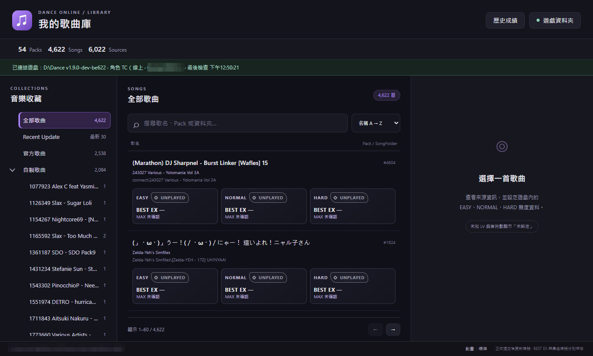
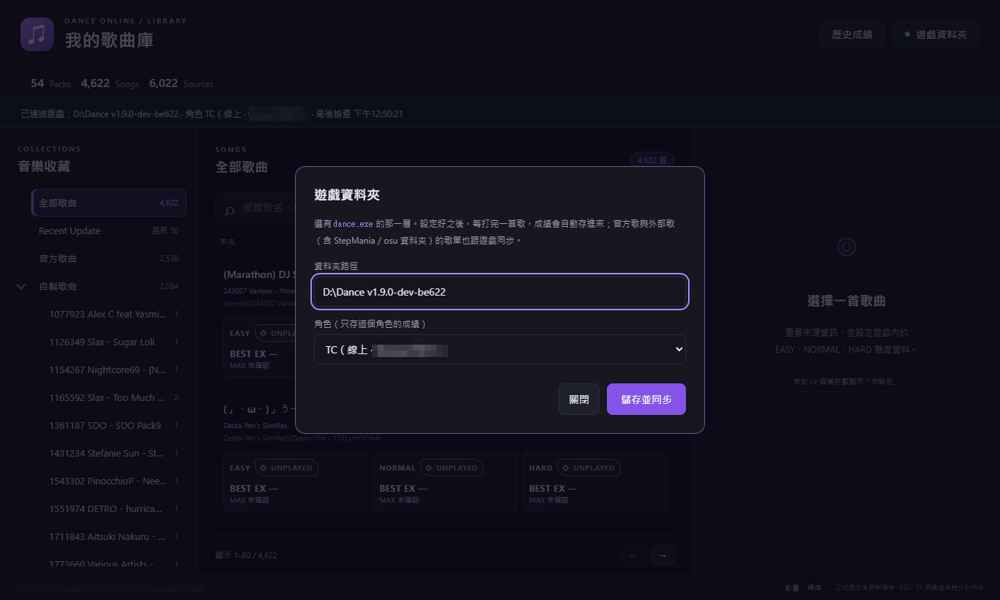
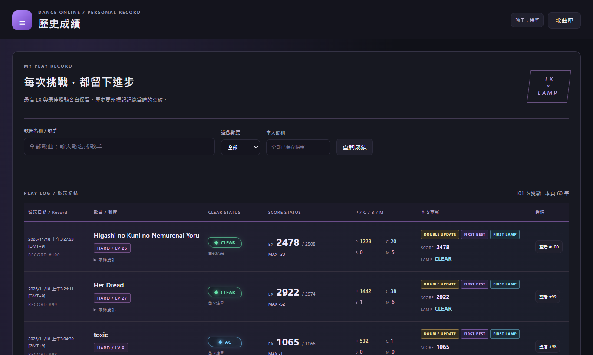
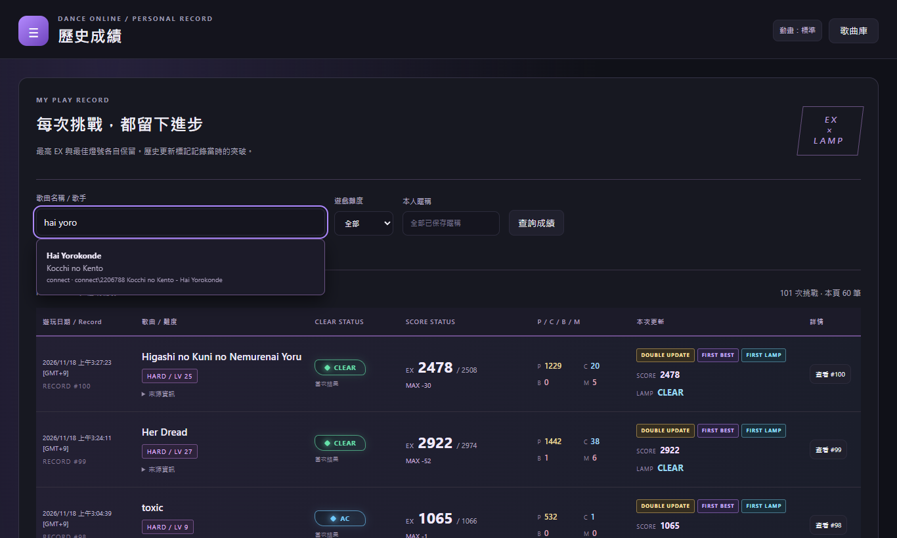

# 熱舞 Online 成績單 · 使用手冊（給一般玩家）

這份手冊用最白話的方式，一步一步教你安裝和使用這個成績工具。不需要懂程式。

> 適用版本：目前的「遊戲資料夾模式」。比較技術性的細節放在[遊戲資料夾模式說明](GAME_RESULTS.md)，這份手冊用不到也沒關係。

---

## 1. 這個工具在做什麼？

- 你每打完一首歌，工具就**自動**把成績記下來，不用截圖、不用手動輸入。
- 它會幫你整理：
  - **我的歌曲庫**：遊戲裡所有歌（官方歌＋自製歌）一起列出，每首歌每個難度的最佳成績和燈號。
  - **歷史成績**：每一次遊玩的紀錄，可以用歌名搜尋。
- 所有資料只存在**你自己的電腦**，不會上傳到網路。

小名詞（看不懂也沒關係）：

| 名詞 | 意思 |
|---|---|
| EX 分數 | Perfect 一個算 2 分、Cool 一個算 1 分，加起來。 |
| MAX | 這首歌全部打 Perfect 時的 EX 分數。 |
| 燈號（CLEAR、FC 等） | 這首歌打完的程度，例如過關、Full Combo。 |

---

## 2. 需要準備什麼？

1. **Windows 電腦**（Windows 10 已確認可用；Windows 11 應該也可以）。
2. **熱舞 Online 遊戲**，而且要是**會寫成績紀錄的新版**（65_remake 11/17 r2221 或更新）。
   - 怎麼確認？用新版打完一首歌後，遊戲角色資料夾裡會出現一個叫 `results.jsonl` 的檔案。工具就是讀這個檔案。
   - 舊版遊戲不會寫這個檔案，工具就拿不到成績。
3. **Python**（免費軟體，工具要靠它執行）。只要裝一次，第 3 步會教你。

---

## 3. 安裝（只要做一次）

### 3-1. 安裝 Python

1. 打開 <https://www.python.org/downloads/windows/>，下載 **Python 3.11**（或更新版）的「Windows installer (64-bit)」。
2. 執行安裝檔。**第一個畫面最下面的「Add python.exe to PATH」一定要打勾**，再按「Install Now」。
3. 等它跑完，按「Close」。

### 3-2. 下載成績工具

1. 打開 <https://github.com/ThomasChung0708/dance-score-system>。
2. 按綠色的「**Code**」按鈕 →「**Download ZIP**」。
3. 下載後，在 ZIP 檔上按右鍵 →「**全部解壓縮**」，放到你好找的地方，例如 `D:\DanceScore`。
   - 建議不要放在「下載」資料夾裡，以免哪天清理時被刪掉。

這樣就裝好了。不需要另外安裝其他東西。

> 另一種方式：單一執行檔 `DanceScore.exe`（不用裝 Python）。目前網站上沒有直接提供下載，要有人先用 `BuildExe.cmd` 做出來再給你。詳見[第 10 節](#10-單一執行檔-dancescoreexe選用)。

---

## 4. 第一次開啟

1. 打開剛剛解壓縮的資料夾，**雙擊 `LibraryGUI.cmd`**。
2. 會跳出一個**黑色視窗**，接著瀏覽器自動打開「我的歌曲庫」網頁。
   - 黑色視窗就是工具本體，**使用期間請開著它**（可以縮小）。
   - 如果出現藍色的「Windows 已保護您的電腦」或安全性警告，按「其他資訊」→「仍要執行」。
   - 如果瀏覽器沒有自己打開，把黑色視窗裡 `http://127.0.0.1:...` 那串網址複製到瀏覽器。
3. 第一次打開時，上方會提示「尚未設定遊戲資料夾」。接著做第 5 步。

---

## 5. 設定遊戲資料夾和角色（只要做一次）

1. 按網頁右上角的「**遊戲資料夾**」。
2. 在「資料夾路徑」貼上你的遊戲資料夾，就是**有 `dance.exe` 的那一層**，例如 `D:\Dance v1.9.0-dev-xxxx`。
   - 小技巧：在檔案總管打開遊戲資料夾，點上方的網址列，就能複製路徑。
3. 按「**儲存並同步**」。第一次會花幾秒鐘讀歌單。
4. 在「**角色**」選單選**你自己的角色**。
   - 「單機」是單機角色，「線上 · 帳號」是線上角色。
   - 工具**只記錄你選的那個角色**的成績。換角色玩的話，記得回來這裡改。
   - 注意：最佳成績和燈號是整個資料庫一起算的。換過角色的話，兩個角色的成績會混在一起。建議固定只用自己的主要角色。
5. 按「關閉」。上方出現綠色的「**已連結遊戲：……角色……**」就代表設定成功。

設定會記住，之後打開工具不用再設。

---

## 6. 平常怎麼用

1. 雙擊 `LibraryGUI.cmd` 打開工具（黑色視窗開著就好）。
2. 照常打開遊戲、照常打歌。
3. 每打完一首，幾秒內成績就自動存進來（工具每 3 秒檢查一次）。「我的歌曲庫」頁面會自己更新；「歷史成績」頁要再按一次「查詢成績」（或按 **F5**）才會看到新的那筆。
4. 打完要關工具時，直接關掉黑色視窗就可以。
   - 忘了開工具也沒關係：成績原本就記在遊戲裡，下次打開工具時會自動補存。

### 多人遊戲也會記嗎？

會。不管你是不是房主，只要是**你自己這台電腦、你選的角色**打完的歌，遊戲都會寫進紀錄，工具就會存。
別人的成績不會記進你的資料。

### 哪些情況不會記？

遊戲本身就不寫的：中途離開、旁觀、看錄像、在譜面編輯器試打、開了自動演奏的那一局。

### 以前玩過的成績呢？

第一次設定好時，新版遊戲已經寫過的紀錄會一起匯入。用舊版遊戲玩的（沒有寫紀錄的）就沒辦法補。

---

## 7. 看成績

### 7-1. 我的歌曲庫

- 左邊「**音樂收藏**」：全部歌曲、最近更新（Recent Update）、官方歌曲、自製歌曲（可以展開看各歌包）。
- 中間搜尋框可以打歌名、歌包或資料夾名稱。
- 每首歌下面有 EASY／NORMAL／HARD 三個難度，各自顯示**最佳 EX 分數**和**燈號**。
- 點一首歌，右邊會顯示詳細資料。

### 7-2. 歷史成績（可以用歌名搜尋）

1. 按右上角的「**歷史成績**」。
2. 在「**歌曲名稱 / 歌手**」打幾個字，例如 `hai yoro`、`恋`、`ミク`。
   - 大小寫、全形半形、空格都不用管，打歌手名字也找得到。
3. 下面會跳出建議清單，每一項有**歌名、歌手、來源**（官方或哪個歌包）。**點一首歌**（或用 ↑↓ 選，再按 Enter）。
4. 按「**查詢成績**」。
   - 欄位**留空**再按查詢，就是看全部歌曲。
   - 打了字但沒從清單選的話，只找到一首會自動幫你選；找到很多首時會請你從清單選一首。
5. 也可以用「遊戲難度」篩選。
6. 每一行可以按「查看」看那次的詳細數字。

想回到歌曲庫，按右上的「歌曲庫」。

### 關於「本人暱稱」

使用遊戲資料夾模式時，工具會自動用你選的角色名字當作暱稱，**不用自己填**。歷史成績頁的「本人暱稱」欄位只是篩選用，留空就好。

---

## 8. 資料存在哪裡？怎麼備份？

- 你的所有成績都在工具資料夾裡的 **`data`** 資料夾：
  - `data\library.sqlite3`：成績和歌曲資料（最重要）。
  - `data\game-settings.json`：你設定的遊戲資料夾和角色。
  - `data\backups\`：工具自動做的備份。每次有新成績進來時備份一次，只留最近 10 份。
- **自己備份**：先關掉黑色視窗，再把整個 `data` 資料夾複製到隨身碟或雲端硬碟。
- **換電腦**：在新電腦照第 3 步安裝，再把舊的 `data` 資料夾整個複製過去（覆蓋），打開後確認遊戲資料夾路徑是否要改。
- **更新工具到新版**：照第 3-2 步下載新的 ZIP，解壓縮到**新的**資料夾，再把舊資料夾的 `data` 複製過去。不要直接用新檔案蓋掉舊資料夾，以免不小心蓋到 `data`。
- 不要把 `data` 資料夾傳給別人或貼到網路上，裡面是你的個人紀錄。

---

## 9. 常見問題

**Q1. 打完歌，成績沒出現？** 依序檢查：

1. 黑色視窗有沒有開著？沒開的話雙擊 `LibraryGUI.cmd` 打開，它會自動補存還沒存的成績。
2. 在「歷史成績」頁再按一次「查詢成績」，或按 **F5** 重新整理。
3. 上方綠色條是不是顯示「已連結遊戲」，角色是不是**你剛剛玩的那個**？不對的話到「遊戲資料夾」重新選角色。
4. 遊戲是不是新版（第 2 節）？如果顯示「這個角色還沒有成績紀錄檔」，通常代表遊戲還是舊版，或這個角色還沒用新版打過歌。
5. 那一局是不是中途離開、旁觀或開了自動（第 6 節）？這些遊戲本來就不記。
6. 上方狀態有寫「**筆格式不正確未存**」嗎？這代表遊戲寫的紀錄有地方對不上，工具為了不存錯資料就先跳過。已知的例子是**判定總數跟整首歌的判定數不一樣**（多人遊戲偶爾會發生）。這種成績目前不會存，工具也不會自己重試（遊戲的原始紀錄還在，之後版本修好時才有機會補）。請在關掉工具前把這段訊息截圖，連同歌名和時間私下告訴維護者。
7. 上方寫「**筆等歌單更新後再存**」：那首官方歌還不在歌單裡（通常是遊戲剛更新），歌單更新後會自動補存，不用處理。

**Q2. 在「遊戲資料夾」視窗裡看到「遊戲還沒有歌曲快取」？**
打開遊戲、進一次選歌畫面，遊戲就會產生歌曲清單，工具接著會自動讀到。

**Q3. 雙擊 `LibraryGUI.cmd` 後，黑色視窗出現錯誤並停在「請按任意鍵繼續」？**
通常是 Python 沒裝好或版本太舊（需要 3.10 以上）。重新照第 3-1 步安裝 Python，記得勾選「Add python.exe to PATH」。如果還是不行，把黑色視窗的文字截圖給維護者。

**Q4. 工具更新後畫面沒變？**
關掉黑色視窗，重新雙擊 `LibraryGUI.cmd`，再在網頁按 **Ctrl + F5**。

**Q5. 設定時說「裡面沒有 dance.exe」？**
路徑選錯層了。要選**直接看得到 `dance.exe`** 的那個資料夾，不是上一層，也不是 `DATA` 資料夾。

**Q6. 以前的「即時監控」「待確認成績」按鈕不見了？**
新版遊戲會直接寫成績，所以不再需要畫面辨識（OCR）的監控和人工確認，這兩個按鈕已經拿掉了。舊的程式還留著當備用，一般玩家用不到。

**Q7. 回報問題時要提供什麼？**
歌名、大概的時間、單人或多人、官方歌或自製歌、畫面上的訊息（可以截圖）。請**私下**傳給維護者，不要把 `data` 資料夾或含有其他玩家名字的截圖貼到公開的地方。

---

## 10. 單一執行檔 DanceScore.exe（選用）

`DanceScore.exe` 是打包好的單一檔案，**不用裝 Python**，用法跟 `LibraryGUI.cmd` 一樣（雙擊 → 黑色視窗 → 網頁）。

- 目前網站上**沒有現成的 exe 可以下載**。要有人在**裝了 Python 3.11**（一定要有 3.11，只有更新的版本不行）、而且能上網的電腦上雙擊 `BuildExe.cmd`，做好的檔案會在 `dist\DanceScore.exe`，再把這個檔案給你。
- 別人做好傳給你的 exe 沒有數位簽章，Windows 可能跳出藍色警告，按「其他資訊」→「仍要執行」。只執行你信任的人給的檔案。
- 建議把 exe 放進**它自己的資料夾**（例如 `D:\DanceScore`）。
- **注意：exe 的資料放在「exe 旁邊的 `data` 資料夾」。**
  - 所以如果你本來用 `LibraryGUI.cmd`，第一次改用 exe 時，exe 會從一個**空的**新資料庫開始，看起來像成績不見了（其實舊的還在原本的 `data` 裡）。
  - 想沿用舊成績：先關掉所有黑色視窗，把原本的 `data` 資料夾整個複製到 exe 旁邊，再打開 exe。
  - 兩種方式請選一種固定使用，不要兩邊輪流用，不然成績會分散在兩個資料庫。
- exe 沒有畫面辨識（OCR）功能，但遊戲資料夾模式不需要它。

---

## 相關文件

- [遊戲資料夾模式說明](GAME_RESULTS.md)：工具讀哪些檔、紀錄格式（技術細節）。
- [朋友安裝與使用說明（舊版 OCR 流程）](FRIEND_SETUP.md)：給還想用畫面辨識的人，一般玩家不需要。